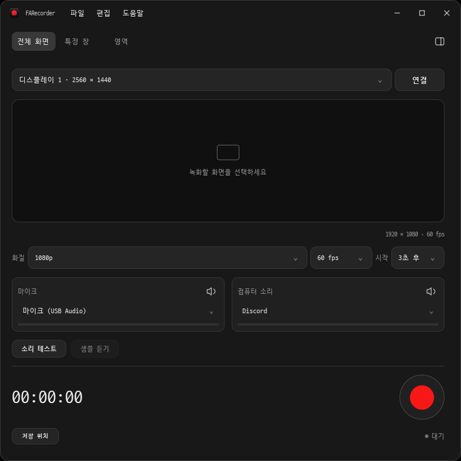

# FARecorder

[](LICENSE)

A modern desktop recorder built with **C++20 + Qt 6 / QML**, with native capture backends for Windows and macOS.

**0.4.0-beta.1 Windows 베타를 배포합니다.** [다운로드 및 변경 내용](https://github.com/yanggogi1423/cpp-screen-recorder/releases/tag/v0.4.0-beta.1). 기능을 구현했다는 것과 실제 장비에서 검증했다는 것을 구분합니다. 최종 지원 상태와 테스트 증거는 [기능 점검표](docs/FEATURE_AUDIT.md)에 기록합니다. 베타(pre-release)이며 정식 안정 버전은 아닙니다.



[확장 화면](docs/images/expanded.png) · [녹화 중 최적 화면](docs/images/compact.png) · [프로그램 정보](docs/images/about.png) · [0.4 검증 결과](docs/VALIDATION-0.4.md) · [UI 설계](docs/DESIGN.md)

## 만들고 있는 경험

- 전체 디스플레이 / 특정 창 / 드래그한 영역 녹화
- 영역 선택 시 원본 픽셀 크기로 저장, 녹화·일시정지 중 테두리 드래그로 위치 이동
- 해상도 직접 입력, 1–240 FPS 요청값, CPU 및 플랫폼별 GPU 인코더 선택
- 시작 지연 0–60초: 0이면 즉시, 기본은 3초
- 앱별 소리·마이크·시스템 소리를 독립된 오디오 트랙과 WAV로 저장
- **녹화 중에도** 트랙별 음량 0–200% / 뮤트 / 실제 입력에 따른 피크 표시
- 운영체제의 스피커·통화 마이크 음량과 분리된 녹화용 믹서
- 녹화 종료 후 재생·시작/종료 구간 자르기
- 편집 저장 시 **새 파일 저장 / 원본 덮어쓰기 / 취소**를 명시적으로 선택
- **MP4 기본 저장**, 기본·확장 화면과 파일 메뉴에서 저장 폴더 지정
- 검정 테마, 간소화/확장 화면 전환, 설정 유지
- **D2Coding 1.4.0** 일반·굵은 글꼴 내장: 메뉴·설정·타이머에 공통 적용, 별도 글꼴 설치 불필요
- 녹화 시작 시 400×104 최적 화면: 타이머·일시정지/재개·정지·화면 복귀
- 파일 / 편집 / 도움말 메뉴: 버전·제작자·마지막 업데이트·GitHub 링크 (최적 화면에서는 숨김)
- Windows 기본 제목 표시줄 제거, 창 이동·최대화·크기 조절
- 녹화 버튼을 모티브로 생성한 앱 아이콘과 녹화·정지·일시정지 버튼 이미지
- 녹화 전 5초 오디오 샘플 테스트와 샘플 듣기
- 선택한 해상도/FPS의 실제 CPU·GPU 인코딩 사전 검사
- 일시정지/재개: 멈춘 시간을 영상과 모든 오디오 트랙에서 함께 제외
- 전역 시작/종료·일시정지 단축키 (도움말 → 단축키)
- 창·앱·장치 목록 자동 갱신, 실제 이름을 보여 주는 오디오 선택기
- 한 줄 상단바와 오른쪽 패널 아이콘, 마이크/컴퓨터 소리 믹서 탭

현재 macOS 마이크 경로는 시스템 기본 입력 장치 1개를 사용합니다. Windows는 입력 장치별로 선택할 수 있으며, macOS의 개별 입력 장치 선택은 보강 대상입니다.

## 사용 순서

1. 화면·창·오디오 소스는 시작 시와 변경 시 자동으로 갱신됩니다. macOS는 화면·오디오 녹화 권한이 필요합니다.
2. 전체 화면 / 특정 창 / 영역 지정을 고르고 소스를 연결합니다. 영역 모드는 **영역 선택** 후 드래그합니다. 선택 영역의 실제 크기가 출력 해상도가 되며, 녹화 중에도 이동 손잡이나 테두리를 드래그할 수 있습니다. [영역 녹화 안내](docs/REGION_RECORDING.md)
3. 녹음할 앱과 마이크를 선택합니다. Windows의 앱 목록에는 오디오 세션을 만든 프로그램이 표시되므로, 해당 앱에서 소리를 재생하면 목록에 자동으로 나타납니다.
4. **소리 테스트**로 선택한 소스를 5초간 확인하고 **샘플 듣기**로 결과를 확인합니다. 사용자 마이크 선택/권한 허용이 필요하며 녹화 파일을 만들지는 않습니다.
5. **저장 위치** 또는 **파일 → 녹화 폴더 지정…**으로 저장 폴더를 고릅니다. 기본은 동영상 폴더의 `FARecorder`이며 MP4로 저장합니다. 해상도·FPS·시작 지연을 정하고, 확장 화면에서 인코더·MKV 형식·앱별 믹서를 설정할 수 있습니다.
6. 녹화를 시작하면 처음 또는 설정 변경 후 실제 인코딩 검사를 통과한 다음 카운트다운/녹화가 시작됩니다.
7. 녹화가 시작되면 메뉴가 없는 **최적 화면**으로 자동 축소됩니다. `↗`로 기존 화면에 돌아와 선택한 트랙의 음량·뮤트를 조절하고, **최적 모드**로 다시 줄일 수 있습니다. 종료하면 이전 화면과 창 크기로 돌아옵니다. 선택한 소스 자체는 녹화 중 바꿀 수 없습니다. 영역 모드는 같은 모니터 안에서 캡처 위치를 이동할 수 있습니다.
8. 종료 후 편집 화면에서 재생·자르기를 하고 저장 방식을 선택합니다.

Windows는 **Ctrl+R**로 시작/종료, **Ctrl+P**로 일시정지/재개합니다. macOS는 **⌘R / ⌘P**를 사용합니다. 앱이 뒤에 있어도 동작하는 OS 전역 단축키입니다. 다른 앱과 충돌하면 등록 실패를 표시하며, 앱 안의 버튼을 사용할 수 있습니다. 카운트다운과 인코더 검사 중 `Esc`로 취소할 수 있습니다.

## 오디오 저장과 믹서

지정한 저장 폴더 아래 `FARecorder_날짜_시간_식별자` 세션 폴더를 만듭니다. 각 세션 폴더에는 영상 원본 `video.mkv`, 개별 RF64 `.wav`, 여러 AAC 트랙이 담긴 `recording.mkv` 또는 `.mp4`, 로그와 `session.json`이 저장됩니다. RF64는 일반 WAV의 4 GiB 크기 한계를 피합니다.

오디오가 2개 이상이면 일반 플레이어용 전체 믹스 트랙을 기본 트랙으로 추가하고, 독립 트랙도 함께 보관합니다. 멀티트랙을 지원하는 편집기에서 개별 트랙을 조절할 수 있습니다.

녹화용 믹서는 녹음되는 PCM에 적용되며 운영체제 음량 설정을 바꾸지 않습니다. 뮤트한 구간은 해당 트랙에 무음으로 기록되므로 나중에 원래 소리를 복원할 수 없습니다. 중복 녹음을 막기 위해 시스템 전체 소리와 앱별 소리는 동시에 선택하지 않으며, 마이크는 어느 쪽과도 함께 선택할 수 있습니다.

## 개발 환경

- CMake 3.24 이상, C++20 컴파일러, Qt 6.8.3
- Windows: Windows 11 권장. 앱별 오디오는 Windows 빌드 20348 이상 필요. Visual Studio 2022 C++ 데스크톱 도구 및 Windows SDK
- macOS: macOS 13 이상, Xcode command-line tools. 마이크는 AVFoundation 경로 사용
- 녹화·편집용 FFmpeg (`libx264`와 AAC 필요)

### Windows

```powershell
./tools/setup-windows.ps1
./tools/build-windows.ps1 -Deploy
./dist/FARecorder-Windows-x64/bin/FARecorder.exe
```

Qt와 빌드 의존성은 프로젝트 `.deps` / `.venv`에 설치합니다. FFmpeg는 프로젝트 `tools/ffmpeg/bin`에 설치하며 시스템 PATH나 권한 설정은 변경하지 않습니다. `QT_ROOT_DIR`로 기존 Qt 설치를 지정할 수도 있습니다.

개발 실행 시 Qt DLL 경로가 필요합니다.

```powershell
$env:PATH="$PWD/.deps/Qt/6.8.3/msvc2022_64/bin;$env:PATH"
./build/FARecorder.exe
```

### macOS

Qt 6.8.3의 `qtmultimedia` 모듈을 설치하고 Qt 경로를 `CMAKE_PREFIX_PATH`에 지정합니다. FFmpeg를 `tools/ffmpeg/bin/ffmpeg`에 배치하거나 실행 파일 옆에 둡니다.

```sh
cmake -S . -B build -G Ninja -DCMAKE_BUILD_TYPE=Release -DCMAKE_PREFIX_PATH=/path/to/Qt/6.8.3/macos
cmake --build build --parallel
ctest --test-dir build --output-on-failure
cmake --install build --prefix dist/FARecorder-macOS
```

macOS 빌드/기본 테스트/배포는 CI에서 통과했습니다. 물리 Mac에서 권한 허용, 실제 녹화, 마이크·앱별 소리, 편집을 검증하기 전에는 macOS 녹화 기능의 동작을 보장하지 않습니다. 개발 빌드는 서명·공증되지 않았습니다.

## 구조와 테스트

공용 코어와 플랫폼 경계, 타임스탬프·복구·믹서 설계는 [ARCHITECTURE.md](docs/ARCHITECTURE.md)를 참고하세요.

```powershell
# 실제 Windows API로 앱 자신의 창 + 두 테스트 프로세스 오디오를 녹화합니다.
# 약한 테스트 톤 두 개가 잠깐 재생됩니다. 다른 앱의 화면이나 마이크를 녹음하지 않습니다.
./tools/test-windows-workflow.ps1
./tools/test-windows-workflow.ps1 -StopPaused
# 정상 workflow 결과를 남긴 뒤 실행합니다. 덮어쓰기는 테스트 복사본에만 수행합니다.
./tools/test-windows-editor.ps1
# 소리 재생 없이 자체 색상 창의 영역 녹화·이동을 검증합니다.
./tools/test-windows-region.ps1
```

테스트 산출물은 `artifacts/`에만 저장되며 Git에 포함되지 않습니다. 자동 UI 테스트는 네이티브 캡처/청감/성능 검증을 대신하지 않습니다.

## 알려진 한계

현재 CPU 메모리를 거쳐 인코딩하므로 높은 해상도·FPS를 설정할 수 있어도 실제 처리 성능은 하드웨어에 따라 달라집니다. GPU 인코더는 호환 드라이버와 하드웨어가 필요합니다. HDR, 게임 후킹, 예약 종료, 웹캠/PIP, 주석, 노이즈 억제, 자동 업데이트는 아직 없습니다. 브라우저 탭별 소리나 한 프로세스 안의 통화 참여자별 소리 분리는 지원하지 않습니다.

현재 버전은 보강·디버깅·UI 폴리싱을 거친 Windows 베타입니다. 물리 Mac 녹화와 장시간·고부하 인수 시험 후 정식 릴리즈를 진행합니다. 의존성 고지와 배포 정책은 [THIRD_PARTY_NOTICES.md](THIRD_PARTY_NOTICES.md)를 확인하세요.

## 제품 정보

프로그램 이름은 **FARecorder**, 제작자 표기는 GitHub 저장소 소유자 **yanggogi1423**입니다. 도움말에 현재 버전과 마지막 코드 업데이트 날짜(2026-10-28), [저장소](https://github.com/yanggogi1423/cpp-screen-recorder) 링크를 표시합니다. 업데이트 날짜는 마지막 확인 시각이나 자동 업데이트 확인 결과가 아닙니다.

이전 Luma 설정은 처음 실행할 때 저장 폴더·해상도·FPS·화면 모드를 가져옵니다. 새 이름에서는 MP4를 기본으로 시작하며, 이후 확장 화면에서 직접 선택한 형식은 유지합니다. 내부 C++ namespace / QML URI `Luma`는 호환성을 위해 유지합니다.

## 라이선스

FARecorder의 직접 작성한 코드·문서·프로젝트 아트워크는 [MIT License](LICENSE)이며 저작권 표기는 `Copyright (c) 2026 yanggogi1423`입니다. 서드파티 구성요소에는 해당 라이선스를 적용하지 않습니다.

앱에 내장한 D2Coding 1.4.0 Regular/Bold는 NAVER의 [SIL OFL 1.1](app/assets/fonts/OFL.txt), Qt와 FFmpeg는 각각의 기존 라이선스를 따릅니다. 원문 고지는 배포본에 포함되며 **도움말 → 오픈소스 라이선스**에서도 확인할 수 있습니다. [THIRD_PARTY_NOTICES.md](THIRD_PARTY_NOTICES.md)에 구분을 기록합니다.

UI 변경 기준은 [DESIGN.md](docs/DESIGN.md)입니다. 기본 검사는 소리를 재생하지 않으며, 톤을 재생하는 오디오 통합 검사는 사용자가 요청한 경우에만 수행합니다.
